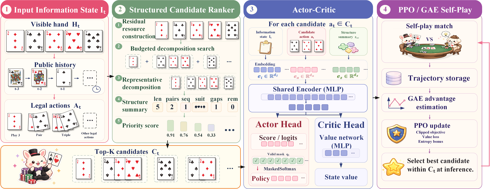
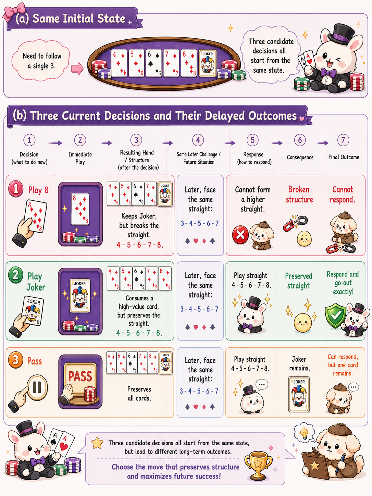
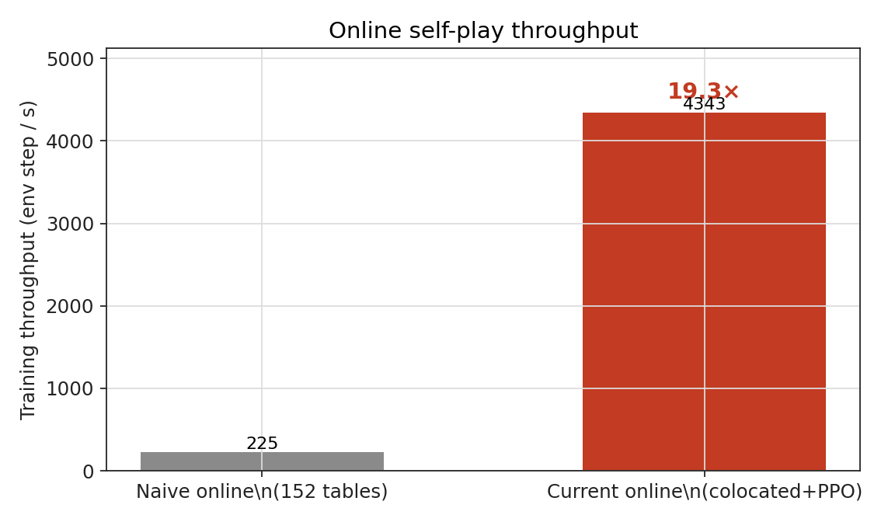
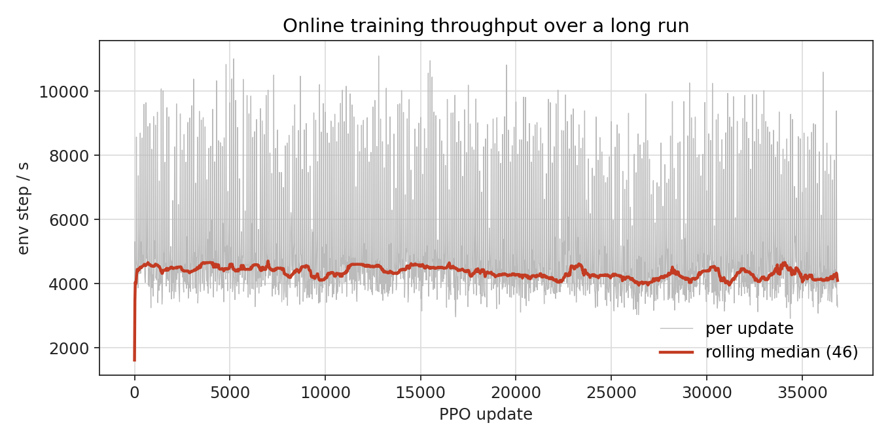
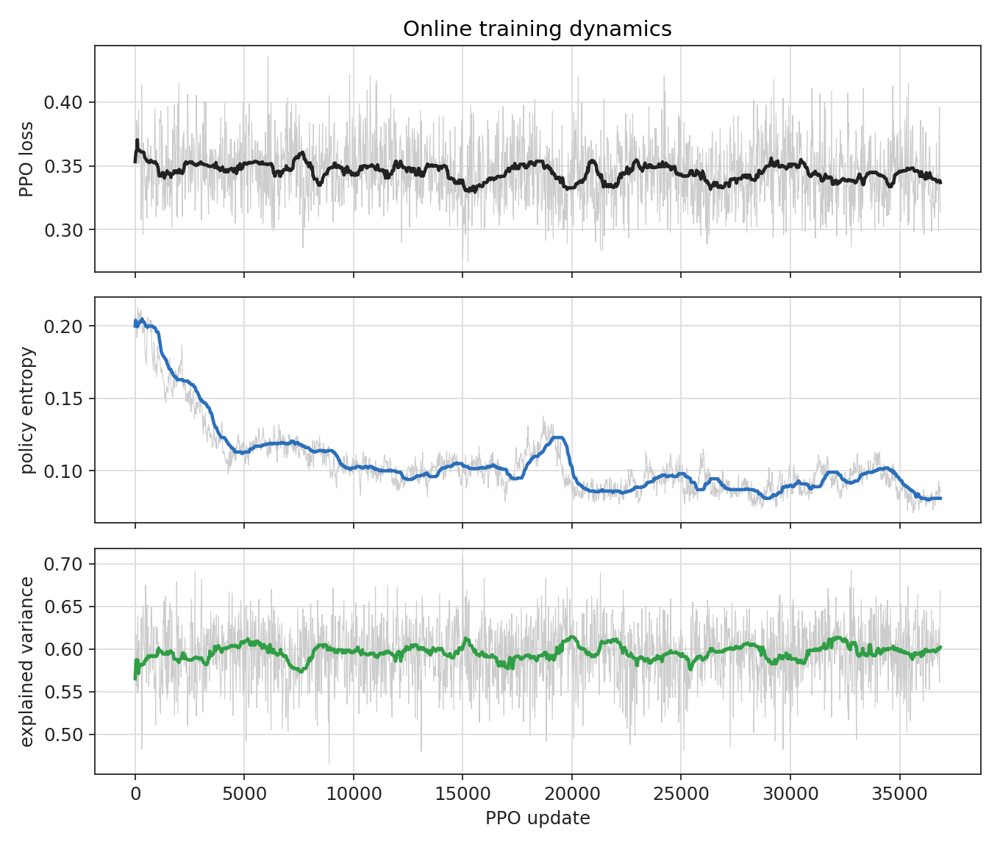
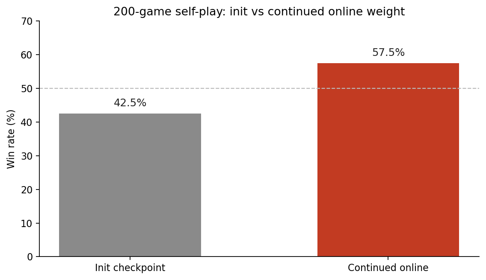

<p align="right">
  <strong>English</strong> | <a href="technical-report.zh-CN.md">简体中文</a>
</p>

# DanKS-Train Technical Report: Architecture & Online Self-Play Training

This report details the architectural design, online self-play reinforcement learning pipeline, and empirical training dynamics behind **DanKS-Train**.

---

## 1. System Architecture

GuanDan (掼蛋) is an imperfect-information, partnership-based card game with a combinatorial action space exceeding $10^6$ distinct legal moves in early turns. Standard discrete policy heads cannot directly score such spaces without aggressive pruning or domain-specific bias.

DanKS resolves this challenge through a four-stage decoupled pipeline:

<p align="center">
  
</p>

1. **Information State Encoding**: Encodes the player's private hand, public play history (who played what in order), current promotion rank, and partnership context.
2. **Budgeted Structural Retrieval**: Decomposes the visible hand into legal combinations and extracts a strategically diverse subset of candidates (Top-10 actions).
3. **Candidate Scoring**: A shared neural policy network evaluates the candidate set against the information state, producing action logits and state value estimates.
4. **Trajectory Optimization**: Trajectories generated from self-play provide Generalized Advantage Estimation (GAE) for clipped PPO policy updates.

### Delayed Structural Outcomes

A core difficulty in GuanDan is that seemingly cheap or greedy plays can dismantle critical remaining hand structures (e.g., breaking a high straight or bomb). Conversely, playing a high-value card early can preserve structural integrity and create a cleaner endgame exit.

<p align="center">
  
</p>

DanKS tackles this by computing explicit remaining-hand features for each candidate and letting the critic assign credit across multi-step delayed outcomes.

---

## 2. High-Throughput Colocated Online PPO

Traditional reinforcement learning pipelines for complex card games often decouple simulation actors from learner GPUs via disk (dumping offline rollout archives such as `.npz` files) or distributed messaging queues. In multi-agent card games with combinatorial action validation, disk I/O and process IPC overhead severely bottleneck throughput.

DanKS-Train implements an in-memory **colocated training architecture**:
- Environment simulation tables, structural candidate retrieval, and batched policy inference share host memory and GPU resources on a single node.
- Rollouts are stored in ring buffers and immediately consumed for PPO mini-batch updates without intermediate disk writes.

### Throughput Comparison

<p align="center">
  
</p>

| Setup | env step / s | Relative Throughput |
| --- | ---: | ---: |
| Naive multi-table online | 225.19 | 1.0× |
| **Colocated online PPO** | **~4,340** (warm median) | **~19.3×** |

*Note: Baseline measured using unbatched table simulation. Colocated numbers reflect sustained warm-run median on single GPU.*

---

## 3. Training Dynamics & Stability

### Throughput Stability Over Long Runs

The colocated training pipeline sustains steady throughput across tens of thousands of PPO updates without memory leaks or actor degradation.

<p align="center">
  
</p>

### Learning Curves

The figure below illustrates the progression of key reinforcement learning signals over a long online self-play run:

<p align="center">
  
</p>

- **PPO Loss (Top)**: Oscillates stably around 0.35 without gradient explosion or policy divergence.
- **Policy Entropy (Middle)**: Gradually decreases from ~0.20 to ~0.08, indicating transition from broad exploration to a focused, confident tactical policy.
- **Explained Variance (Bottom)**: Remains stable between 0.58 and 0.61, verifying that the critic maintains accurate value estimation throughout training.

---

## 4. Playing Strength Evaluation

To measure policy improvement independently of training loss, we conduct a 200-game head-to-head match between the initial baseline checkpoint and the continued online weight released in `v0.1.0`.

To eliminate positional bias, the two models swap team seats (0/2 vs 1/3) after each game.

<p align="center">
  
</p>

| Checkpoint | Win Rate | Average Score / Game |
| --- | ---: | ---: |
| Initial baseline weight | 42.5% | -0.1117 |
| **Continued online weight (`v0.1.0`)** | **57.5%** | **+0.1117** |

*Evaluation executed using `python -m DanKS.training.eval_vs_ckpt` with seed 2026.*

---

## 5. Evidence Reproduction

Raw metrics and reproduction scripts are included in the repository:

- Metric logs: `assets/evidence/online_training_metrics.csv`
- Evaluation results: `assets/evidence/eval_init_vs_latest_200.json`
- Speed comparison data: `assets/evidence/speed_comparison.csv`

To reproduce the charts:

```bash
# Export metrics from raw training log
python scripts/export_online_metrics.py \
  --log /path/to/online.log \
  --out-csv assets/evidence/online_training_metrics.csv \
  --stride 20

# Regenerate throughput, speedup, and convergence plots
python scripts/plot_open_source_evidence.py \
  --metrics-csv assets/evidence/online_training_metrics.csv \
  --out-dir assets \
  --baseline-steps-per-sec 225.19 \
  --baseline-label $'Naive online\n(tables)' \
  --current-label $'Current online\n(colocated+PPO)'
```
